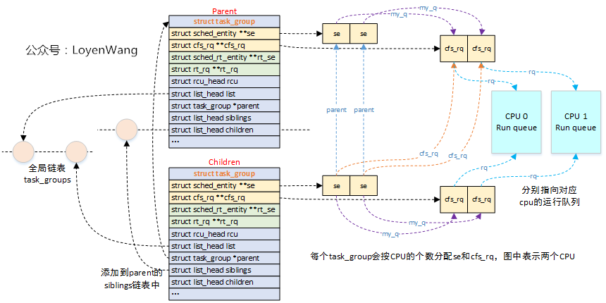
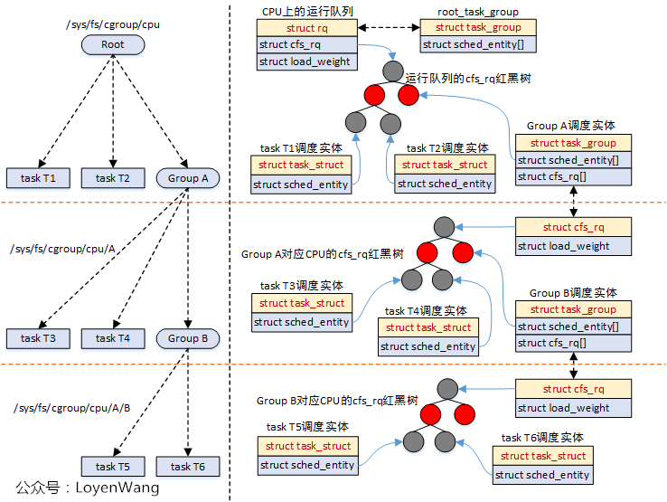
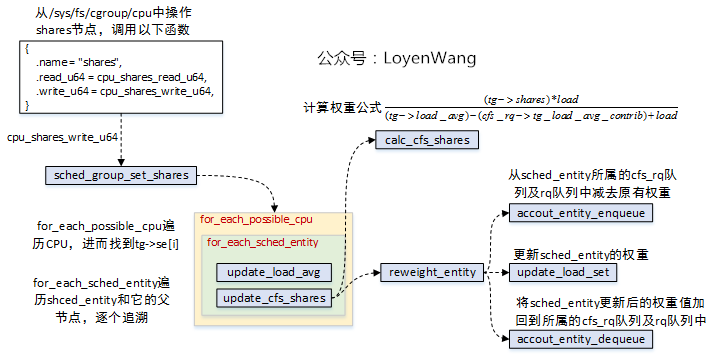
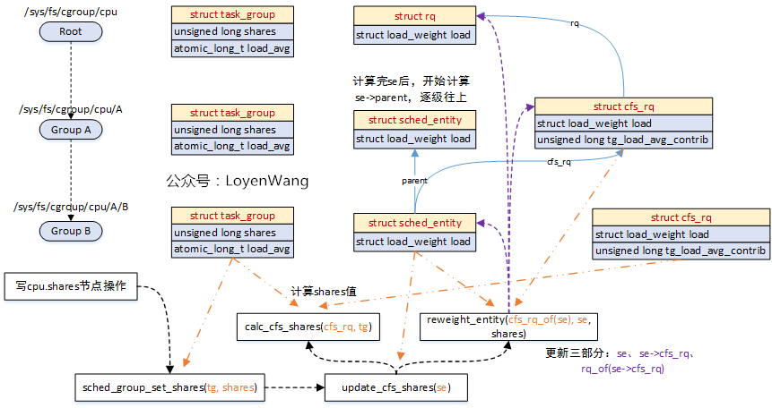
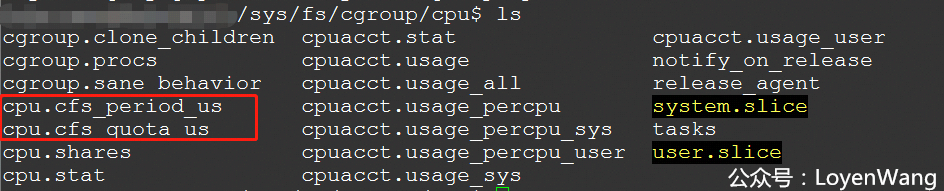
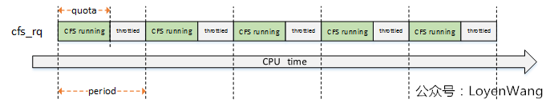
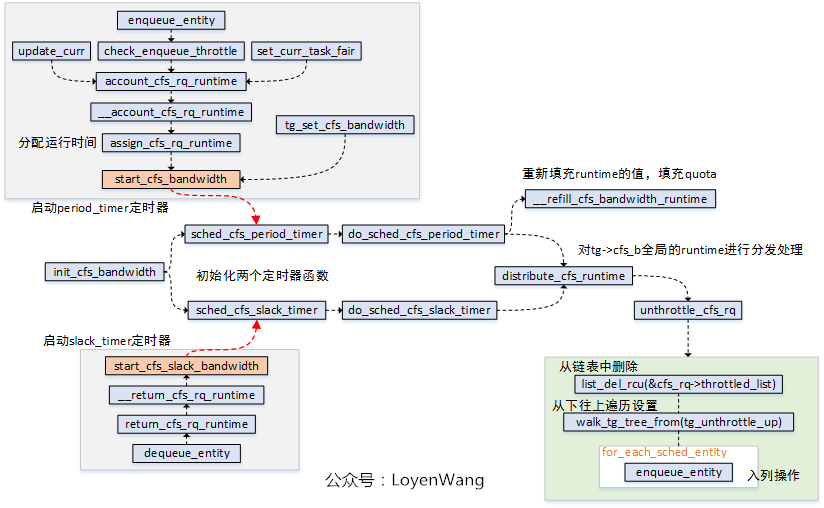
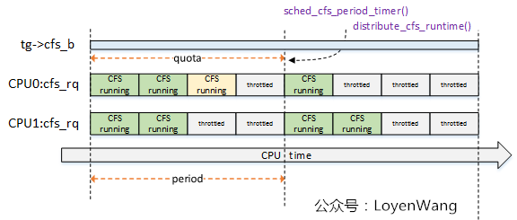
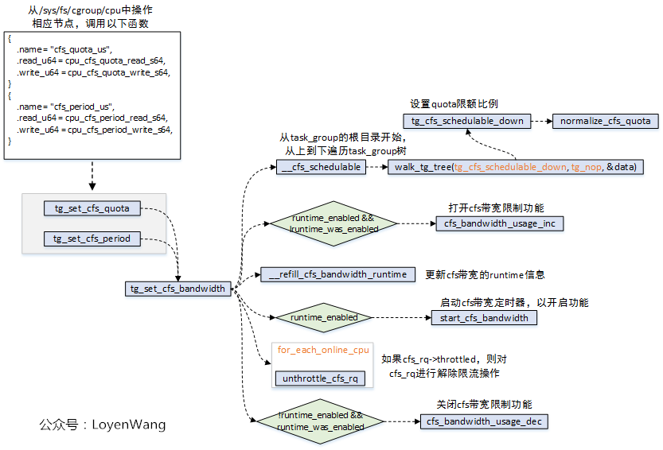
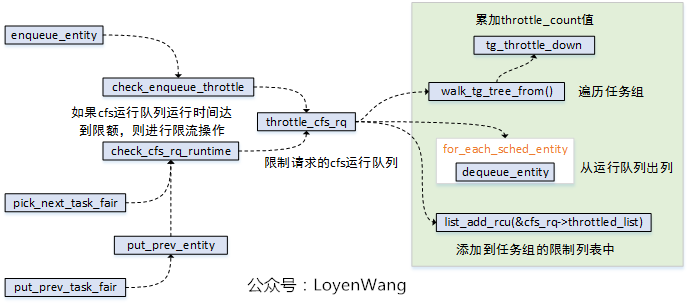

# Linux进程调度-组调度及带宽控制

> Source: https://www.cnblogs.com/LoyenWang/p/12459000.html


## 背景

- `Read the fucking source code!` --By 鲁迅
- `A picture is worth a thousand words.` --By 高尔基

说明：

1. Kernel版本：4.14
2. ARM64处理器，Contex-A53，双核
3. 使用工具：Source Insight 3.5， Visio

## 1. 概述

组调度（`task_group`）是使用Linux `cgroup(control group)`的cpu子系统来实现的，可以将进程进行分组，按组来分配CPU资源等。
比如，看一个实际的例子：
A和B两个用户使用同一台机器，A用户16个进程，B用户2个进程，如果按照进程的个数来分配CPU资源，显然A用户会占据大量的CPU时间，这对于B用户是不公平的。组调度就可以解决这个问题，分别将A、B用户进程划分成组，并将两组的权重设置成占比50%即可。

带宽（`bandwidth`）控制，是用于控制用户组（`task_group`）的CPU带宽，通过设置每个用户组的限额值，可以调整CPU的调度分配。在给定周期内，当用户组消耗CPU的时间超过了限额值，该用户组内的任务将会受到限制。

由于组调度和带宽控制紧密联系，因此本文将探讨这两个主题，本文的讨论都基于CFS调度器，开始吧。

## 2. task_group

- 组调度，在内核中是通过`struct task_group`来组织的，`task_group`本身支持`cfs组调度`和`rt组调度`，本文主要分析`cfs组调度`。
- CFS调度器管理的是`sched_entity`调度实体，`task_struct（代表进程）`和`task_group（代表进程组）`中分别包含`sched_entity`，进而来参与调度；

关于组调度的相关数据结构，组织如下：



- 内核维护了一个全局链表`task_groups`，创建的`task_group`会添加到这个链表中；
- 内核定义了`root_task_group`全局结构，充当`task_group`的根节点，以它为根构建树状结构；
- `struct task_group`的子节点，会加入到父节点的`siblings`链表中；
- 每个`struct task_group`会分配运行队列数组和调度实体数组（以CFS为例，RT调度类似），其中数组的个数为系统CPU的个数，也就是为每个CPU都分配了运行队列和调度实体；

对应到实际的运行中，如下：



- `struct cfs_rq`包含了红黑树结构，`sched_entity`调度实体参与调度时，都会挂入到红黑树中，`task_struct`和`task_group`都属于被调度对象；
- `task_group`会为每个CPU再维护一个`cfs_rq`，这个`cfs_rq`用于组织挂在这个任务组上的任务以及子任务组，参考图中的`Group A`；
- 调度器在调度的时候，比如调用`pick_next_task_fair`时，会从遍历队列，选择`sched_entity`，如果发现`sched_entity`对应的是`task_group`，则会继续往下选择；
- 由于`sched_entity`结构中存在`parent`指针，指向它的父结构，因此，系统的运行也能从下而上的进行遍历操作，通常使用函数`walk_tg_tree_from`进行遍历；

### 2.2 task_group权重

- 进程或进程组都有权重的概念，调度器会根据权重来分配CPU的时间。
- 进程组的权重设置，可以通过`/sys`文件系统进行设置，比如操作`/sys/fs/cgoup/cpu/A/shares`；

调用流程如下图：



- `sched_group_set_shares`来完成最终的设置；
- `task_group`为每个CPU都分配了一个`sched_entity`，针对当前`sched_entity`设置更新完后，往上对`sched_entity->parent`设置更新，直到根节点；
- `shares`的值计算与`load`相关，因此也需要调用`update_load_avg`进行更新计算；

看一下实际的效果图吧：



- 写节点操作可以通过`echo XXX > /sys/fs/cgroup/cpu/A/B/cpu.shares`；
- 橙色的线代表传入参数指向的对象；
- 紫色的线代表每次更新涉及到的对象，包括三个部分；
- 处理完`sched_entity`后，继续按同样的流程处理`sched_entity->parent`；

## 3. cfs_bandwidth

先看一下`/sys/fs/cgroup/cpu`下的内容吧：



- 有两个关键的字段：`cfs_period_us`和`cfs_quota_us`，这两个与cfs_bandwidth息息相关；
- `period`表示周期，`quota`表示限额，也就是在`period`期间内，用户组的CPU限额为`quota`值，当超过这个值的时候，用户组将会被限制运行（`throttle`），等到下一个周期开始被解除限制（`unthrottle`）；

来一张图直观理解一下：



- 在每个周期内限制在`quota`的配额下，超过了就`throttle`，下一个周期重新开始；

### 3.1 数据结构

内核中使用`struct cfs_bandwidth`来描述带宽，该结构包含在`struct task_group`中。
此外，`struct cfs_rq`中也有与带宽控制相关的字段。
还是来看一下代码吧：

```c
struct cfs_bandwidth {
##ifdef CONFIG_CFS_BANDWIDTH
	raw_spinlock_t lock;
	ktime_t period;
	u64 quota, runtime;
	s64 hierarchical_quota;
	u64 runtime_expires;

	int idle, period_active;
	struct hrtimer period_timer, slack_timer;
	struct list_head throttled_cfs_rq;

	/* statistics */
	int nr_periods, nr_throttled;
	u64 throttled_time;
##endif
};
```

- period：周期值；
- quota：限额值；
- runtime：记录限额剩余时间，会使用quota值来周期性赋值；
- hierarchical_quota：层级管理任务组的限额比率；
- runtime_expires：每个周期的到期时间；
- idle：空闲状态，不需要运行时分配；
- period_active：周期性计时已经启动；
- period_timer：高精度周期性定时器，用于重新填充运行时间消耗；
- slack_timer：延迟定时器，在任务出列时，将剩余的运行时间返回到全局池里；
- throttled_cfs_rq：限流运行队列列表；
- nr_periods/nr_throttled/throttled_time：统计值；

`struct cfs_rq`结构中相关字段如下：

```c
struct cfs_rq {
...
##ifdef CONFIG_CFS_BANDWIDTH
	int runtime_enabled;
	u64 runtime_expires;
	s64 runtime_remaining;

	u64 throttled_clock, throttled_clock_task;
	u64 throttled_clock_task_time;
	int throttled, throttle_count;
	struct list_head throttled_list;
##endif /* CONFIG_CFS_BANDWIDTH */
...
}
```

- runtime_enabled：周期计时器使能；
- runtime_expires：周期计时器到期时间；
- runtime_remaining：剩余的运行时间；

### 3.2 流程分析

#### 3.2.1 初始化流程

先看一下初始化的操作，初始化函数`init_cfs_bandwidth`本身比较简单，完成的工作就是将`struct cfs_bandwidth`结构体进程初始化。



- 注册两个高精度定时器：`period_timer`和`slack_timer`；
- `period_timer`定时器，用于在时间到期时重新填充关联的任务组的限额，并在适当的时候`unthrottle`cfs运行队列；
- `slack_timer`定时器，`slack_period`周期默认为5ms，在该定时器函数中也会调用`distribute_cfs_runtime`从全局运行时间中分配runtime；
- `start_cfs_bandwidth`和`start_cfs_slack_bandwidth`分别用于启动定时器运行，其中可以看出在`dequeue_entity`的时候会去利用`slack_timer`，将运行队列的剩余时间返回给`tg->cfs_b`这个`runtime pool`；
- `unthrottle_cfs_rq`函数，会将`throttled_list`中的对应`cfs_rq`删除，并且从下往上遍历任务组，针对每个任务组调用`tg_unthrottle_up`处理，最后也会根据`cfs_rq`对应的`sched_entity`从下往上遍历处理，如果`sched_entity`不在运行队列上，那就重新`enqueue_entity`以便参与调度运行，这个也就完成了解除限制的操作；

`do_sched_cfs_period_timer`函数与`do_sched_cfs_slack_timer()`函数都调用了`distrbute_cfs_runtime()`，该函数用于分发`tg->cfs_b`的全局运行时间`runtime`，用于在该`task_group`中平衡各个CPU上的`cfs_rq`的运行时间`runtime`，来一张示意图：



- 系统中两个CPU，因此`task_group`针对每个cpu都维护了一个`cfs_rq`，这些`cfs_rq`来共享该`task_group`的限额运行时间；
- CPU0上的运行时间，浅黄色模块表示超额了，那么在下一个周期的定时器点上会进行弥补处理；

#### 3.2.2 用户设置流程

用户可以通过操作`/sys`中的节点来进行设置：



- 操作`/sys/fs/cgroup/cpu/`下的`cfs_quota_us/cfs_period_us`节点，最终会调用到`tg_set_cfs_bandwidth`函数；
- `tg_set_cfs_bandwidth`会从`root_task_group`根节点开始，遍历组调度树，并逐个设置限额比率 ；
- 更新`cfs_bandwidth`的`runtime`信息；
- 如果使能了`cfs_bandwidth`功能，则启动带宽定时器；
- 遍历`task_group`中的每个`cfs_rq`队列，设置`runtime_remaining`值，如果`cfs_rq`队列限流了，则需要进行解除限流操作；

#### 3.2.3 `throttle`限流操作

`cfs_rq`运行队列被限制，是在`throttle_cfs_rq`函数中实现的，其中调用关系如下图：



- 调度实体`sched_entity`入列时，进行检测是否运行时间已经达到限额，达到则进行限制处理；
- `pick_next_task_fair/put_prev_task_fair`在选择任务调度时，也需要进行检测判断；

#### 3.2.4 总结

总体来说，带宽控制的原理就是通过`task_group`中的`cfs_bandwidth`来管理一个全局的时间池，分配给属于这个任务组的运行队列，当超过限额的时候则限制队列的调度。同时，`cfs_bandwidth`维护两个定时器，一个用于周期性的填充限额并进行时间分发处理，一个用于将未用完的时间再返回到时间池中，大抵如此。

组调度和带宽控制就先分析到此，下篇文章将分析`CFS调度器`了，敬请期待。
