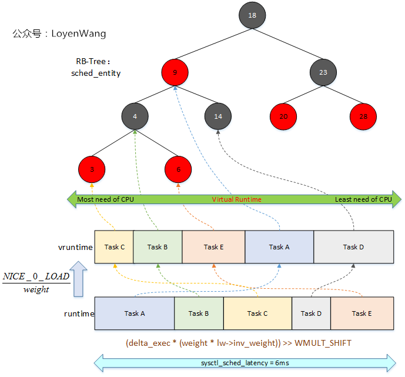
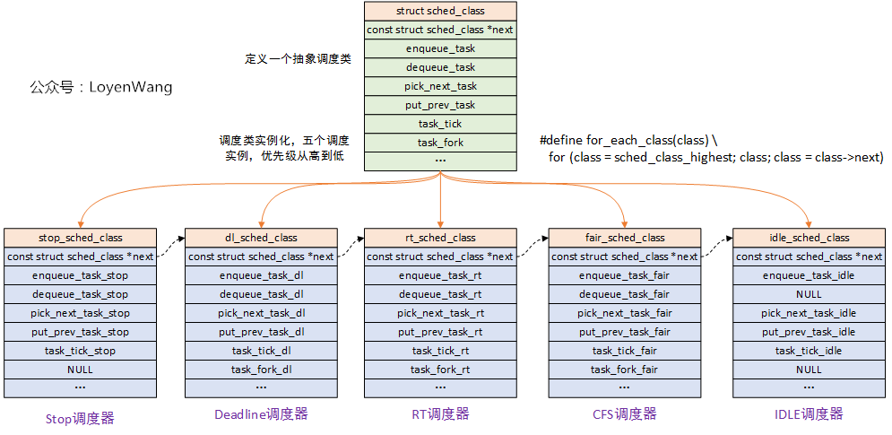
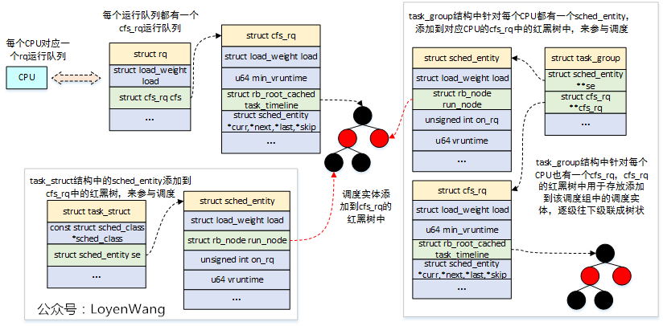
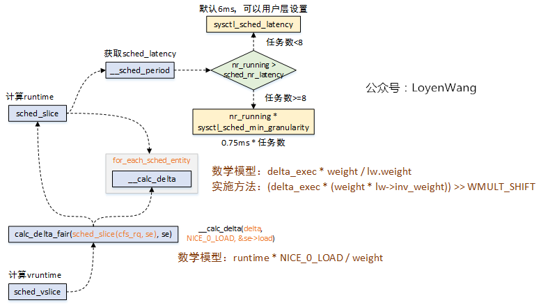
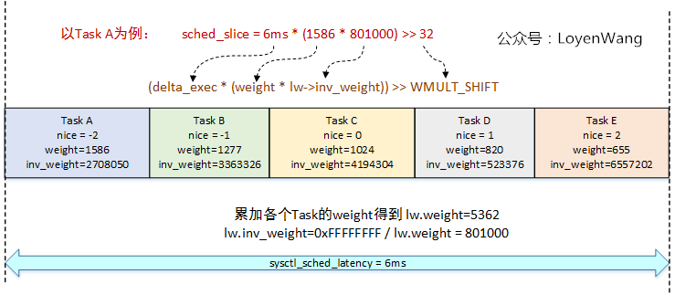
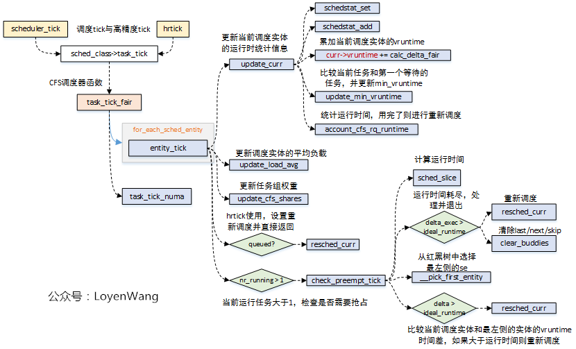
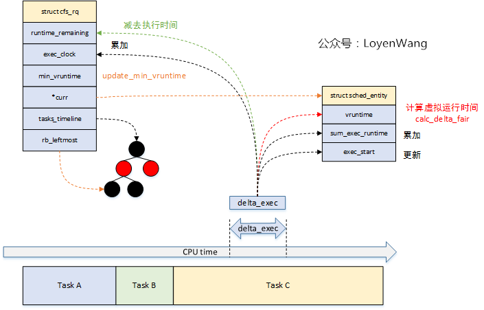
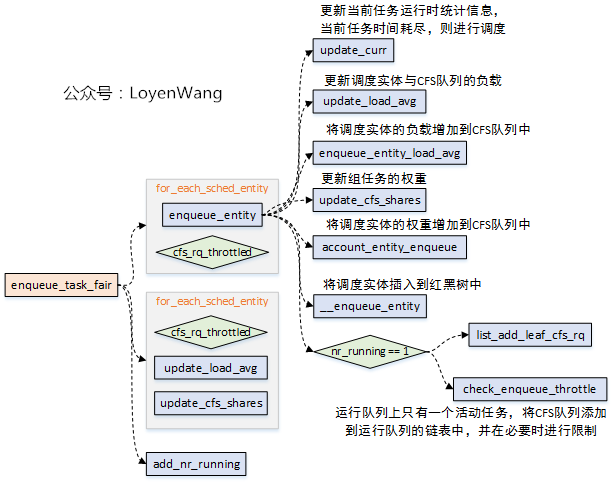
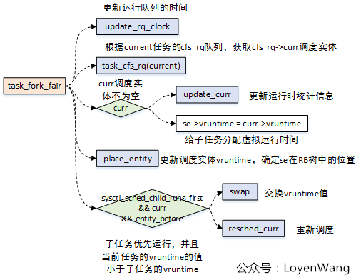
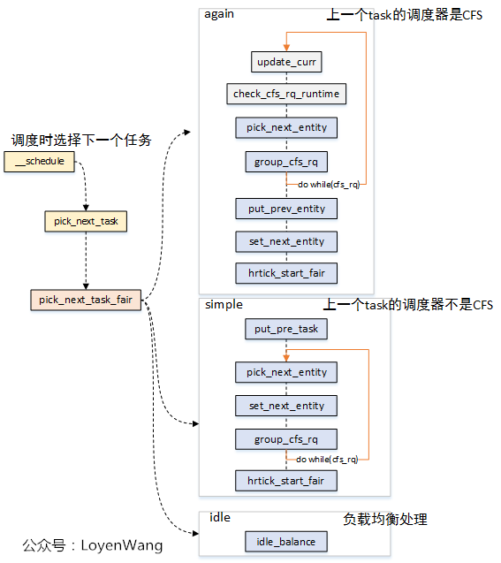

# Linux进程调度-CFS调度器

> Source: https://www.cnblogs.com/LoyenWang/p/12495319.html


## 背景

- `Read the fucking source code!` --By 鲁迅
- `A picture is worth a thousand words.` --By 高尔基

说明：

1. Kernel版本：4.14
2. ARM64处理器，Contex-A53，双核
3. 使用工具：Source Insight 3.5， Visio

## 1. 概述

- `Completely Fair Scheduler`，完全公平调度器，用于Linux系统中普通进程的调度。
- `CFS`采用了红黑树算法来管理所有的调度实体`sched_entity`，算法效率为`O(log(n))`。`CFS`跟踪调度实体`sched_entity`的虚拟运行时间`vruntime`，平等对待运行队列中的调度实体`sched_entity`，将执行时间少的调度实体`sched_entity`排列到红黑树的左边。
- 调度实体`sched_entity`通过`enqueue_entity()`和`dequeue_entity()`来进行红黑树的出队入队。

老规矩，先上张图片来直观了解一下原理：



- 每个`sched_latency`周期内，根据各个任务的权重值，可以计算出运行时间`runtime`；
- 运行时间`runtime`可以转换成虚拟运行时间`vruntime`；
- 根据虚拟运行时间的大小，插入到CFS红黑树中，虚拟运行时间少的调度实体放置到左边；
- 在下一次任务调度的时候，选择虚拟运行时间少的调度实体来运行；

在开始本文之前，建议先阅读下`（一）Linux进程调度器-基础`。

开始探索之旅！

## 2. 数据结构

### 2.1 调度类

Linux内核抽象了一个调度类`struct sched_class`，这是一种典型的面向对象的设计思想，将共性的特征抽象出来封装成类，在实例化各个调度器的时候，可以根据具体的调度算法来实现。这种方式做到了高内聚低耦合，同时又很容易扩展新的调度器。



- 在调度核心代码`kernel/sched/core.c`中，使用的方式是`task->sched_class->xxx_func`，其中`task`表示的是描述任务的结构体`struct task_struck`，在该结构体中包含了任务所使用的调度器，进而能找到对应的函数指针来完成调用执行，有点类似于C++中的多态机制。

### 2.2 rq/cfs_rq/task_struct/task_group/sched_entity

- `struct rq`：每个CPU都有一个对应的运行队列；
- `struct cfs_rq`：CFS运行队列，该结构中包含了`struct rb_root_cached`红黑树，用于链接调度实体`struct sched_entity`。`rq`运行队列中对应了一个CFS运行队列，此外，在`task_group`结构中也会为每个CPU再维护一个CFS运行队列；
- `struct task_struct`：任务的描述符，包含了进程的所有信息，该结构中的`struct sched_entity`，用于参与CFS的调度；
- `struct task_group`：组调度（参考前文），Linux支持将任务分组来对CPU资源进行分配管理，该结构中为系统中的每个CPU都分配了`struct sched_entity`调度实体和`struct cfs_rq`运行队列，其中`struct sched_entity`用于参与CFS的调度；
- `struct sched_entity`：调度实体，这个也是CFS调度管理的对象了；

来一张图看看它们之间的组织关系：



- `struct sched_entity`结构体字段注释如下：

```c
struct sched_entity {
	/* For load-balancing: */
	struct load_weight		load;                   //调度实体的负载权重值
	struct rb_node			run_node;             //用于连接到CFS运行队列的红黑树中的节点
	struct list_head		group_node;          //用于连接到CFS运行队列的cfs_tasks链表中的节点
	unsigned int			on_rq;              //用于表示是否在运行队列中

	u64				exec_start;             //当前调度实体的开始执行时间
	u64				sum_exec_runtime;   //调度实体执行的总时间
	u64				vruntime;           //虚拟运行时间，这个时间用于在CFS运行队列中排队
	u64				prev_sum_exec_runtime;  //上一个调度实体运行的总时间

	u64				nr_migrations;      //负载均衡

	struct sched_statistics		statistics;     //统计信息

##ifdef CONFIG_FAIR_GROUP_SCHED
	int				depth;      //任务组的深度，其中根任务组的深度为0，逐级往下增加
	struct sched_entity		*parent;        //指向调度实体的父对象
	/* rq on which this entity is (to be) queued: */
	struct cfs_rq			*cfs_rq;        //指向调度实体归属的CFS队列，也就是需要入列的CFS队列
	/* rq "owned" by this entity/group: */
	struct cfs_rq			*my_q;      //指向归属于当前调度实体的CFS队列，用于包含子任务或子的任务组
##endif

##ifdef CONFIG_SMP
	/*
	 * Per entity load average tracking.
	 *
	 * Put into separate cache line so it does not
	 * collide with read-mostly values above.
	 */
	struct sched_avg		avg ____cacheline_aligned_in_smp;   //用于调度实体的负载计算（`PELT`）
##endif
};
```

- struct cfs_rq结构体的关键字段注释如下：

```c
/* CFS-related fields in a runqueue */
struct cfs_rq {
	struct load_weight load;        //CFS运行队列的负载权重值
	unsigned int nr_running, h_nr_running;  //nr_running：运行的调度实体数（参与时间片计算）

	u64 exec_clock;     //运行时间
	u64 min_vruntime;   //最少的虚拟运行时间，调度实体入队出队时需要进行增减处理
##ifndef CONFIG_64BIT
	u64 min_vruntime_copy;
##endif

	struct rb_root_cached tasks_timeline;   //红黑树，用于存放调度实体

	/*
	 * 'curr' points to currently running entity on this cfs_rq.
	 * It is set to NULL otherwise (i.e when none are currently running).
	 */
	struct sched_entity *curr, *next, *last, *skip; //分别指向当前运行的调度实体、下一个调度的调度实体、CFS运行队列中排最后的调度实体、跳过运行的调度实体

##ifdef	CONFIG_SCHED_DEBUG
	unsigned int nr_spread_over;
##endif

##ifdef CONFIG_SMP
	/*
	 * CFS load tracking
	 */
	struct sched_avg avg;       //计算负载相关
	u64 runnable_load_sum;
	unsigned long runnable_load_avg;        //基于PELT的可运行平均负载
##ifdef CONFIG_FAIR_GROUP_SCHED
	unsigned long tg_load_avg_contrib;      //任务组的负载贡献
	unsigned long propagate_avg;
##endif
	atomic_long_t removed_load_avg, removed_util_avg;
##ifndef CONFIG_64BIT
	u64 load_last_update_time_copy;
##endif

##ifdef CONFIG_FAIR_GROUP_SCHED
	/*
	 *   h_load = weight * f(tg)
	 *
	 * Where f(tg) is the recursive weight fraction assigned to
	 * this group.
	 */
	unsigned long h_load;
	u64 last_h_load_update;
	struct sched_entity *h_load_next;
##endif /* CONFIG_FAIR_GROUP_SCHED */
##endif /* CONFIG_SMP */

##ifdef CONFIG_FAIR_GROUP_SCHED
	struct rq *rq;	/* cpu runqueue to which this cfs_rq is attached */     //指向CFS运行队列所属的CPU RQ运行队列

	/*
	 * leaf cfs_rqs are those that hold tasks (lowest schedulable entity in
	 * a hierarchy). Non-leaf lrqs hold other higher schedulable entities
	 * (like users, containers etc.)
	 *
	 * leaf_cfs_rq_list ties together list of leaf cfs_rq's in a cpu. This
	 * list is used during load balance.
	 */
	int on_list;
	struct list_head leaf_cfs_rq_list;
	struct task_group *tg;	/* group that "owns" this runqueue */       //CFS运行队列所属的任务组

##ifdef CONFIG_CFS_BANDWIDTH
	int runtime_enabled;    //CFS运行队列中使用CFS带宽控制
	u64 runtime_expires;    //到期的运行时间
	s64 runtime_remaining;      //剩余的运行时间

	u64 throttled_clock, throttled_clock_task;  //限流时间相关
	u64 throttled_clock_task_time;
	int throttled, throttle_count;      //throttled：限流，throttle_count：CFS运行队列限流次数
	struct list_head throttled_list;    //运行队列限流链表节点，用于添加到cfs_bandwidth结构中的cfttle_cfs_rq链表中
##endif /* CONFIG_CFS_BANDWIDTH */
##endif /* CONFIG_FAIR_GROUP_SCHED */
};
```

## 3. 流程分析

整个流程分析，围绕着`CFS调度类实体：fair_sched_class`中的关键函数来展开。

先来看看`fair_sched_class`都包含了哪些函数：

```c
/*
 * All the scheduling class methods:
 */
const struct sched_class fair_sched_class = {
	.next			= &idle_sched_class,
	.enqueue_task		= enqueue_task_fair,
	.dequeue_task		= dequeue_task_fair,
	.yield_task		= yield_task_fair,
	.yield_to_task		= yield_to_task_fair,

	.check_preempt_curr	= check_preempt_wakeup,

	.pick_next_task		= pick_next_task_fair,
	.put_prev_task		= put_prev_task_fair,

##ifdef CONFIG_SMP
	.select_task_rq		= select_task_rq_fair,
	.migrate_task_rq	= migrate_task_rq_fair,

	.rq_online		= rq_online_fair,
	.rq_offline		= rq_offline_fair,

	.task_dead		= task_dead_fair,
	.set_cpus_allowed	= set_cpus_allowed_common,
##endif

	.set_curr_task          = set_curr_task_fair,
	.task_tick		= task_tick_fair,
	.task_fork		= task_fork_fair,

	.prio_changed		= prio_changed_fair,
	.switched_from		= switched_from_fair,
	.switched_to		= switched_to_fair,

	.get_rr_interval	= get_rr_interval_fair,

	.update_curr		= update_curr_fair,

##ifdef CONFIG_FAIR_GROUP_SCHED
	.task_change_group	= task_change_group_fair,
##endif
};
```

### 3.1 runtime与vruntime

CFS调度器没有时间片的概念了，而是根据实际的运行时间和虚拟运行时间来对任务进行排序，从而选择调度。
那么，运行时间和虚拟运行时间是怎么计算的呢？看一下流程调用：



- Linux内核默认的`sysctl_sched_latency`是6ms，这个值用户态可设。`sched_period`用于保证可运行任务都能至少运行一次的时间间隔；
- 当可运行任务大于8个的时候，`sched_period`的计算则需要根据任务个数乘以最小调度颗粒值，这个值系统默认为0.75ms；
- 每个任务的运行时间计算，是用`sched_period`值，去乘以该任务在整个CFS运行队列中的权重占比；
- 虚拟运行的时间 = 实际运行时间 * NICE_0_LOAD / 该任务的权重；

还是来看一个实例吧，以5个Task为例，其中每个Task的`nice`值不一样（优先级不同），对应到的权重值在内核中提供了一个转换数组：

```c
const int sched_prio_to_weight[40] = {
 /* -20 */     88761,     71755,     56483,     46273,     36291,
 /* -15 */     29154,     23254,     18705,     14949,     11916,
 /* -10 */      9548,      7620,      6100,      4904,      3906,
 /*  -5 */      3121,      2501,      1991,      1586,      1277,
 /*   0 */      1024,       820,       655,       526,       423,
 /*   5 */       335,       272,       215,       172,       137,
 /*  10 */       110,        87,        70,        56,        45,
 /*  15 */        36,        29,        23,        18,        15,
};
```

图来了：



### 3.2 CFS调度tick

CFS调度器中的tick函数为`task_tick_fair`，系统中每个调度tick都会调用到，此外如果使用了`hrtimer`，也会调用到这个函数。
流程如下：



主要的工作包括：

- 更新运行时的各类统计信息，比如`vruntime`， 运行时间、负载值、权重值等；
- 检查是否需要抢占，主要是比较运行时间是否耗尽，以及`vruntime`的差值是否大于运行时间等；

来一张图，感受一下`update_curr`函数的相关信息更新吧：



### 3.3 任务出队入队

- 当任务进入可运行状态时，需要将调度实体放入到红黑树中，完成入队操作；
- 当任务退出可运行状态时，需要将调度实体从红黑树中移除，完成出队操作；
- CFS调度器，使用`enqueue_task_fair`函数将任务入队到CFS队列，使用`dequeue_task_fair`函数将任务从CFS队列中出队操作。



- 出队与入队的操作中，核心的逻辑可以分成两部分：1）更新运行时的数据，比如负载、权重、组调度的占比等等；2）将sched_entity插入红黑树，或者从红黑树移除；
- 由于`dequeue_task_fair`大体的逻辑类似，不再深入分析；
- 这个过程中，涉及到了`CPU负载计算`、`task_group组调度`、`CFS Bandwidth带宽控制`等，这些都在前边的文章中分析过，可以结合进行理解；

### 3.3 任务创建

在父进程通过`fork`创建子进程的时候，`task_fork_fair`函数会被调用，这个函数的传入参数是子进程的`task_struct`。该函数的主要作用，就是确定子任务的`vruntime`，因此也能确定子任务的调度实体在红黑树RB中的位置。

`task_fork_fair`本身比较简单，流程如下图：



### 3.4 任务选择

每当进程任务切换的时候，也就是`schedule`函数执行时，调度器都需要选择下一个将要执行的任务。
在CFS调度器中，是通过`pick_next_task_fair`函数完成的，流程如下：



- 当需要进程任务切换的时候，`pick_next_task_fair`函数的传入参数中包含了需要被切换出去的任务，也就是`pre_task`；
- 当`pre_task`不是普通进程时，也就是调度类不是CFS，那么它就不使用`sched_entity`的调度实体来参与调度，因此会执行`simple`分支，通过`put_pre_task`函数来通知系统当前的任务需要被切换，而不是通过`put_prev_entity`函数来完成；
- 当`pre_task`是普通进程时，调用`pick_next_entity`来选择下一个执行的任务，这个选择过程实际是有两种情况：当调度实体对应task时，`do while()`遍历一次，当调度实体对应`task_group`是，则需要遍历任务组来选择下一个执行的任务了。
- `put_prev_entity`，用于切换任务前的准备工作，更新运行时的统计数据，并不进行`dequeue`的操作，其中需要将CFS队列的`curr`指针置位成NULL；
- set_next_entity，用于设置下一个要运行的调度实体，设置CFS队列的`curr`指针；
- 如果使能了`hrtimer`，则将`hrtimer`的到期时间设置为调度实体的剩余运行时间；

暂且分析到这吧，CFS调度器涵盖的内容还是挺多的，`fair.c`一个文件就有将近一万行代码，相关内容的分析也分散在前边的文章中了，感兴趣的可以去看看。

打完收工，洗洗睡了。
