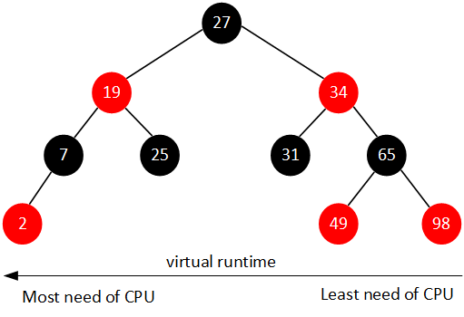
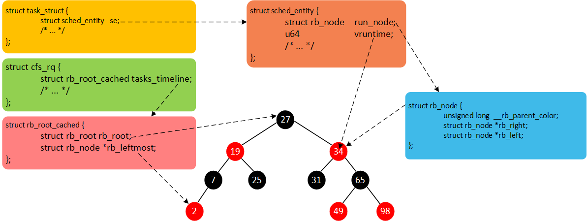

# CFS调度器（1）-基本原理

> Source: http://www.wowotech.net/process_management/447.html


首先需要思考的问题是：什么是调度器（scheduler）？调度器的作用是什么？调度器是一个操作系统的核心部分。可以比作是CPU时间的管理员。调度器主要负责选择某些就绪的进程来执行。不同的调度器根据不同的方法挑选出最适合运行的进程。目前Linux支持的调度器就有RT scheduler、Deadline scheduler、CFS scheduler及Idle scheduler等。我想用一系列文章呈现Linux 调度器的设计原理。

> 注：文章代码分析基于Linux-4.18.0。

## 什么是调度类

从Linux 2.6.23开始，Linux引入scheduling class的概念，目的是将调度器模块化。这样提高了扩展性，添加一个新的调度器也变得简单起来。一个系统中还可以共存多个调度器。在Linux中，将调度器公共的部分抽象，使用`struct sched_class`结构体描述一个具体的调度类。系统核心调度代码会通过`struct sched_class`结构体的成员调用具体调度类的核心算法。先简单的介绍下`struct sched_class`部分成员作用。

```cpp
struct sched_class {	const struct sched_class *next;	void (*enqueue_task) (struct rq *rq, struct task_struct *p, int flags);	void (*dequeue_task) (struct rq *rq, struct task_struct *p, int flags);	void (*check_preempt_curr)(struct rq *rq, struct task_struct *p, int flags);	struct task_struct * (*pick_next_task)(struct rq *rq, struct task_struct *prev, struct rq_flags *rf);    /* ... */}; 
```

 

```

```

> 1. next：next成员指向下一个调度类（比自己低一个优先级）。在Linux中，每一个调度类都是有明确的优先级关系，高优先级调度类管理的进程会优先获得cpu使用权。
> 2. enqueue_task：向该调度器管理的runqueue中添加一个进程。我们把这个操作称为入队。
> 3. dequeue_task：向该调度器管理的runqueue中删除一个进程。我们把这个操作称为出队。
> 4. check_preempt_curr：当一个进程被唤醒或者创建的时候，需要检查当前进程是否可以抢占当前cpu上正在运行的进程，如果可以抢占需要标记TIF_NEED_RESCHED flag。
> 5. pick_next_task：从runqueue中选择一个最适合运行的task。这也算是调度器比较核心的一个操作。例如，我们依据什么挑选最适合运行的进程呢？这就是每一个调度器需要关注的问题。

## Linux中有哪些调度类

Linux中主要包含`dl_sched_class`、`rt_sched_class`、`fair_sched_class`及`idle_sched_class`等调度类。每一个进程都对应一种调度策略，每一种调度策略又对应一种调度类（每一个调度类可以对应多种调度策略）。例如实时调度器以优先级为导向选择优先级最高的进程运行。每一个进程在创建之后，总是要选择一种调度策略。针对不同的调度策略，选择的调度器也是不一样的。不同的调度策略对应的调度类如下表。

|      调度类      |      描述      |         调度策略          |
| :--------------: | :------------: | :-----------------------: |
|  dl_sched_class  | deadline调度器 |      SCHED_DEADLINE       |
|  rt_sched_class  |   实时调度器   |   SCHED_FIFO、SCHED_RR    |
| fair_sched_class | 完全公平调度器 | SCHED_NORMAL、SCHED_BATCH |
| idle_sched_class |   idle task    |        SCHED_IDLE         |

针对以上调度类，系统中有明确的优先级概念。每一个调度类利用next成员构建单项链表。优先级从高到低示意图如下：

```cpp
sched_class_highest----->stop_sched_class                         .next---------->dl_sched_class                                         .next---------->rt_sched_class                                                         .next--------->fair_sched_class                                                                        .next----------->idle_sched_class                                                                                         .next = NULL 
```

``

Linux调度核心在选择下一个合适的task运行的时候，会按照优先级的顺序便利调度类的pick_next_task函数。因此，SCHED_FIFO调度策略的实时进程永远比SCHED_NORMAL调度策略的普通进程优先运行。代码中pick_next_task函数也有体现。pick_next_task函数就是负责选择一个即将运行的进程，以下贴出省略版代码。

```cpp
static inline struct task_struct *pick_next_task(struct rq *rq,                                                 struct task_struct *prev, struct rq_flags *rf){	const struct sched_class *class;	struct task_struct *p; 	for_each_class(class) {          /* 按照优先级顺序便利所有的调度类，通过next指针便利单链表 */		p = class->pick_next_task(rq, prev, rf);		if (p)			return p;	}} 
```

``

针对CFS调度器，管理的进程都属于SCHED_NORMAL或者SCHED_BATCH策略。后面的部分主要针对CFS调度器讲解。

## 普通进程的优先级

CFS是Completely Fair Scheduler简称，即完全公平调度器。CFS的设计理念是在真实硬件上实现理想的、精确的多任务CPU。CFS调度器和以往的调度器不同之处在于没有时间片的概念，而是分配cpu使用时间的比例。例如：2个相同优先级的进程在一个cpu上运行，那么每个进程都将会分配50%的cpu运行时间。这就是要实现的公平。

以上举例是基于同等优先级的情况下。但是现实却并非如此，有些任务优先级就是比较高。那么CFS调度器的优先级是如何实现的呢？首先，我们引入权重的概念，权重代表着进程的优先级。各个进程之间按照权重的比例分配cpu时间。例如：2个进程A和B。A的权重是1024，B的权重是2048。那么A获得cpu的时间比例是1024/(1024+2048) = 33.3%。B进程获得的cpu时间比例是2048/(1024+2048)=66.7%。我们可以看出，权重越大分配的时间比例越大，相当于优先级越高。在引入权重之后，分配给进程的时间计算公式如下：

**分配给进程的时间 = 总的cpu时间 \* 进程的权重/就绪队列（runqueue）所有进程权重之和**

CFS调度器针对优先级又提出了nice值的概念，其实和权重是一一对应的关系。nice值就是一个具体的数字，取值范围是[-20, 19]。数值越小代表优先级越大，同时也意味着权重值越大，nice值和权重之间可以互相转换。内核提供了一个表格转换nice值和权重。

```cpp
const int sched_prio_to_weight[40] = { /* -20 */     88761,     71755,     56483,     46273,     36291, /* -15 */     29154,     23254,     18705,     14949,     11916, /* -10 */      9548,      7620,      6100,      4904,      3906, /*  -5 */      3121,      2501,      1991,      1586,      1277, /*   0 */      1024,       820,       655,       526,       423, /*   5 */       335,       272,       215,       172,       137, /*  10 */       110,        87,        70,        56,        45, /*  15 */        36,        29,        23,        18,        15,}; 
```

``

数组的值可以看作是公式：weight = 1024 / 1.25nice计算得到。公式中的1.25取值依据是：进程每降低一个nice值，将多获得10% cpu的时间。公式中以1024权重为基准值计算得来，1024权重对应nice值为0，其权重被称为NICE_0_LOAD。默认情况下，大部分进程的权重基本都是NICE_0_LOAD。

## 调度延迟

什么是调度延迟？调度延迟就是保证每一个可运行进程都至少运行一次的时间间隔。例如，每个进程都运行10ms，系统中总共有2个进程，那么调度延迟就是20ms。如果有5个进程，那么调度延迟就是50ms。如果现在保证调度延迟不变，固定是6ms，那么系统中如果有2个进程，那么每个进程运行3ms。如果有6个进程，那么每个进程运行1ms。如果有100个进程，那么每个进程分配到的时间就是0.06ms。随着进程的增加，每个进程分配的时间在减少，进程调度过于频繁，上下文切换时间开销就会变大。因此，CFS调度器的调度延迟时间的设定并不是固定的。当系统处于就绪态的进程少于一个定值（默认值8）的时候，调度延迟也是固定一个值不变（默认值6ms）。当系统就绪态进程个数超过这个值时，我们保证每个进程至少运行一定的时间才让出cpu。这个“至少一定的时间”被称为最小粒度时间。在CFS默认设置中，最小粒度时间是0.75ms。用变量sysctl_sched_min_granularity记录。因此，调度周期是一个动态变化的值。调度周期计算函数是__sched_period()。

```cpp
static u64 __sched_period(unsigned long nr_running){	if (unlikely(nr_running > sched_nr_latency))		return nr_running * sysctl_sched_min_granularity;	else		return sysctl_sched_latency;} 
```

``

> nr_running是系统中就绪进程数量，当超过sched_nr_latency时，我们无法保证调度延迟，因此转为保证调度最小粒度。如果nr_running并没有超过sched_nr_latency，那么调度周期就等于调度延迟sysctl_sched_latency（6ms）。

## 虚拟时间（virtual time）

CFS调度器的目标是保证每一个进程的完全公平调度。CFS调度器就像是一个母亲，她有很多个孩子（进程）。但是，手上只有一个玩具（cpu）需要公平的分配给孩子玩。假设有2个孩子，那么一个玩具怎么才可以公平让2个孩子玩呢？简单点的思路就是第一个孩子玩10分钟，然后第二个孩子玩10分钟，以此循环下去。CFS调度器也是这样记录每一个进程的执行时间，保证每个进程获取CPU执行时间的公平。因此，哪个进程运行的时间最少，应该让哪个进程运行。

例如，调度周期是6ms，系统一共2个相同优先级的进程A和B，那么每个进程都将在6ms周期时间内内各运行3ms。如果进程A和B，他们的权重分别是1024和820（nice值分别是0和1）。进程A获得的运行时间是6x1024/(1024+820)=3.3ms，进程B获得的执行时间是6x820/(1024+820)=2.7ms。进程A的cpu使用比例是3.3/6x100%=55%，进程B的cpu使用比例是2.7/6x100%=45%。计算结果也符合上面说的“进程每降低一个nice值，将多获得10% CPU的时间”。很明显，2个进程的实际执行时间是不相等的，但是CFS想保证每个进程运行时间相等。因此CFS引入了虚拟时间的概念，也就是说上面的2.7ms和3.3ms经过一个公式的转换可以得到一样的值，这个转换后的值称作虚拟时间。这样的话，CFS只需要保证每个进程运行的虚拟时间是相等的即可。虚拟时间vriture_runtime和实际时间（wall time）转换公式如下：

```cpp
                                 NICE_0_LOADvriture_runtime = wall_time * ----------------                                    weight 
```

``

进程A的虚拟时间3.3 * 1024 / 1024 = 3.3ms，我们可以看出nice值为0的进程的虚拟时间和实际时间是相等的。进程B的虚拟时间是2.7 * 1024 / 820 = 3.3ms。我们可以看出尽管A和B进程的权重值不一样，但是计算得到的虚拟时间是一样的。因此CFS主要保证每一个进程获得执行的虚拟时间一致即可。在选择下一个即将运行的进程的时候，只需要找到虚拟时间最小的进程即可。为了避免浮点数运算，因此我们采用先放大再缩小的方法以保证计算精度。内核又对公式做了如下转换。

```cpp
                                 NICE_0_LOADvriture_runtime = wall_time * ----------------                                    weight                                     NICE_0_LOAD * 2^32                = (wall_time * -------------------------) >> 32                                        weight                                                                                        2^32                = (wall_time * NICE_0_LOAD * inv_weight) >> 32        (inv_weight = ------------ )                                                                                        weight 
```

``

权重的值已经计算保存到sched_prio_to_weight数组中，根据这个数组我们可以很容易计算inv_weight的值。内核中使用sched_prio_to_wmult数组保存inv_weight的值。计算公式是：sched_prio_to_wmult[i] = 232/sched_prio_to_weight[i]。

```cpp
const u32 sched_prio_to_wmult[40] = { /* -20 */     48388,     59856,     76040,     92818,    118348, /* -15 */    147320,    184698,    229616,    287308,    360437, /* -10 */    449829,    563644,    704093,    875809,   1099582, /*  -5 */   1376151,   1717300,   2157191,   2708050,   3363326, /*   0 */   4194304,   5237765,   6557202,   8165337,  10153587, /*   5 */  12820798,  15790321,  19976592,  24970740,  31350126, /*  10 */  39045157,  49367440,  61356676,  76695844,  95443717, /*  15 */ 119304647, 148102320, 186737708, 238609294, 286331153,}; 
```

``

系统中使用`struct load_weight`结构体描述进程的权重信息。weight代表进程的权重，inv_weight等于232/weight。

```cpp
struct load_weight {	unsigned long		weight;	u32			inv_weight;}; 
```

``

将实际时间转换成虚拟时间的实现函数是calc_delta_fair()。calc_delta_fair()调用__calc_delta()函数，__calc_delta()主要功能是实现如下公式的计算。

```cpp
__calc_delta() = (delta_exec * weight * lw->inv_weight) >> 32                                   weight                                 2^32               = delta_exec * ----------------    (lw->inv_weight = --------------- )                                lw->weight                             lw->weight 
```

``

和上面计算虚拟时间计算公式对比发现。如果需要计算进程的虚拟时间，这里的weight只需要传递参数NICE_0_LOAD，lw参数是进程对应的`struct load_weight`结构体。

```cpp
static u64 __calc_delta(u64 delta_exec, unsigned long weight, struct load_weight *lw){	u64 fact = scale_load_down(weight);	int shift = 32; 	__update_inv_weight(lw); 	if (unlikely(fact >> 32)) {		while (fact >> 32) {			fact >>= 1;			shift--;		}	} 	fact = (u64)(u32)fact * lw->inv_weight; 	while (fact >> 32) {		fact >>= 1;		shift--;	} 	return mul_u64_u32_shr(delta_exec, fact, shift);} 
```

``

按照上面说的理论，calc_delta_fair()函数调用__calc_delta()的时候传递的weight参数是NICE_0_LOAD，lw参数是进程对应的`struct load_weight`结构体。

```cpp
static inline u64 calc_delta_fair(u64 delta, struct sched_entity *se){	if (unlikely(se->load.weight != NICE_0_LOAD))             /* 1 */		delta = __calc_delta(delta, NICE_0_LOAD, &se->load);  /* 2 */ 	return delta;} 
```

``

> 1. 按照之前的理论，nice值为0（权重是NICE_0_LOAD）的进程的虚拟时间和实际时间是相等的。因此如果进程的权重是NICE_0_LOAD，进程对应的虚拟时间就不用计算。
> 2. 调用__calc_delta()函数。

Linux通过`struct task_struct`结构体描述每一个进程。但是调度类管理和调度的单位是调度实体，并不是task_struct。在支持组调度的时候，一个组也会抽象成一个调度实体，它并不是一个task。所以，我们在`struct task_struct`结构体中可以找到以下不同调度类的调度实体。

```cpp
struct task_struct {         struct sched_entity		se;	struct sched_rt_entity		rt;	struct sched_dl_entity		dl;    /* ... */} 
```

``

> se、rt、dl分别对应CFS调度器、RT调度器、Deadline调度器的调度实体。

`struct sched_entity`结构体描述调度实体，包括`struct load_weight`用来记录权重信息。除此以外我们一直关心的时间信息，肯定也要一起记录。`struct sched_entity`结构体简化后如下：

```cpp
struct sched_entity {	struct load_weight		load;	struct rb_node		run_node;	unsigned int		on_rq;	u64			sum_exec_runtime;	u64			vruntime;}; 
```

``

> 1. load：权重信息，在计算虚拟时间的时候会用到inv_weight成员。
> 2. run_node：CFS调度器的每个就绪队列维护了一颗红黑树，上面挂满了就绪等待执行的task，run_node就是挂载点。
> 3. on_rq：调度实体se加入就绪队列后，on_rq置1。从就绪队列删除后，on_rq置0。
> 4. sum_exec_runtime：调度实体已经运行实际时间总合。
> 5. vruntime：调度实体已经运行的虚拟时间总合。

## 就绪队列（runqueue）

系统中每个CPU都会有一个全局的就绪队列（cpu runqueue），使用`struct rq`结构体描述，它是per-cpu类型，即每个cpu上都会有一个`struct rq`结构体。每一个调度类也有属于自己管理的就绪队列。例如，`struct cfs_rq`是CFS调度类的就绪队列，管理就绪态的`struct sched_entity`调度实体，后续通过pick_next_task接口从就绪队列中选择最适合运行的调度实体（虚拟时间最小的调度实体）。`struct rt_rq`是实时调度器就绪队列。`struct dl_rq`是Deadline调度器就绪队列。

```cpp
struct rq {         struct cfs_rq cfs;	struct rt_rq rt;	struct dl_rq dl;}; struct rb_root_cached {	struct rb_root rb_root;	struct rb_node *rb_leftmost;}; struct cfs_rq {	struct load_weight load;	unsigned int nr_running;	u64 min_vruntime;	struct rb_root_cached tasks_timeline;}; 
```

``

> 1. load：就绪队列权重，就绪队列管理的所有调度实体权重之和。
> 2. nr_running：就绪队列上调度实体的个数。
> 3. min_vruntime：跟踪就绪队列上所有调度实体的最小虚拟时间。
> 4. tasks_timeline：用于跟踪调度实体按虚拟时间大小排序的红黑树的信息（包含红黑树的根以及红黑树中最左边节点）。

CFS维护了一个按照虚拟时间排序的红黑树，所有可运行的调度实体按照p->se.vruntime排序插入红黑树。如下图所示。

[](http://www.wowotech.net/content/uploadfile/201810/afa01538905321.png)

 

CFS选择红黑树最左边的进程运行。随着系统时间的推移，原来左边运行过的进程慢慢的会移动到红黑树的右边，原来右边的进程也会最终跑到最左边。因此红黑树中的每个进程都有机会运行。

现在我们总结一下。Linux中所有的进程使用`task_struct`描述。`task_struct`包含很多进程相关的信息（例如，优先级、进程状态以及调度实体等）。但是，每一个调度类并不是直接管理`task_struct`，而是引入调度实体的概念。CFS调度器使用`sched_entity`跟踪调度信息。CFS调度器使用`cfs_rq`跟踪就绪队列信息以及管理就绪态调度实体，并维护一棵按照虚拟时间排序的红黑树。`tasks_timeline->rb_root`是红黑树的根，`tasks_timeline->rb_leftmost`指向红黑树中最左边的调度实体，即虚拟时间最小的调度实体（为了更快的选择最适合运行的调度实体，因此`rb_leftmost`相当于一个缓存）。每个就绪态的调度实体`sched_entity`包含插入红黑树中使用的节点`rb_node`，同时`vruntime`成员记录已经运行的虚拟时间。我们将这几个数据结构简单梳理，如下图所示。

[](http://www.wowotech.net/content/uploadfile/201810/8bb51538905306.png)

 
