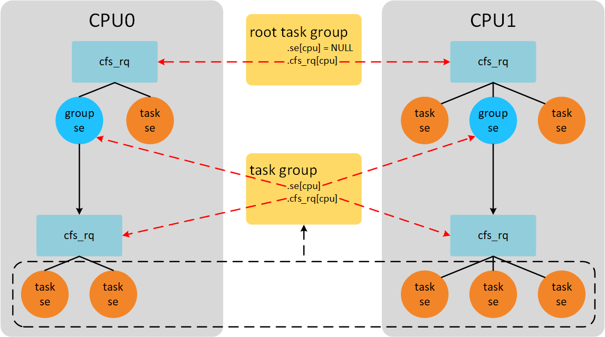
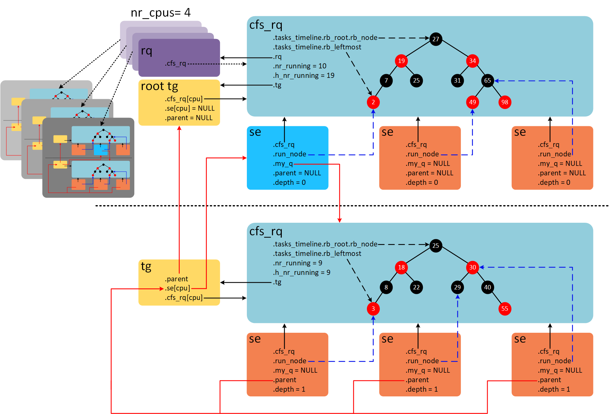
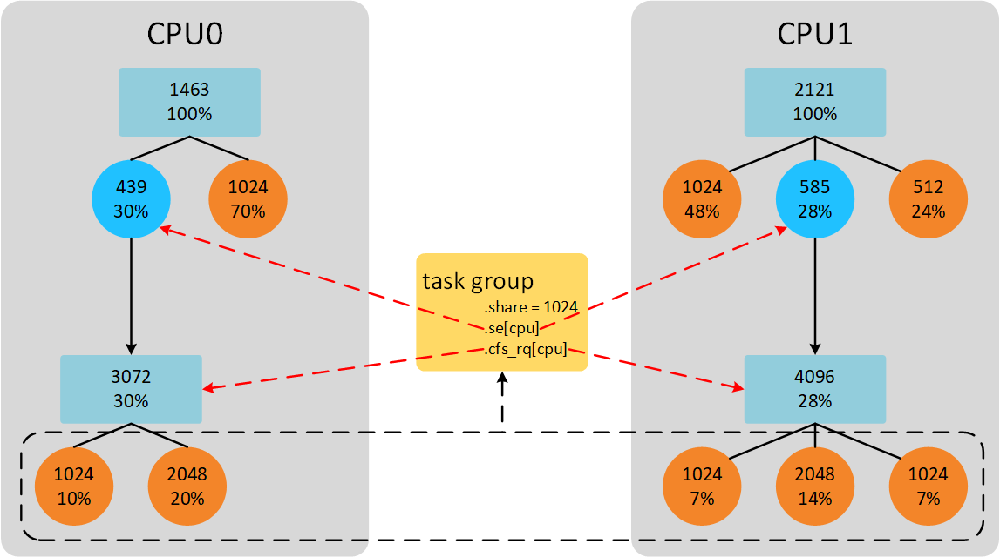
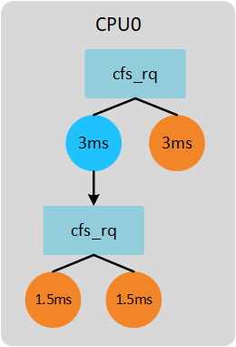

# CFS调度器（3）-组调度


> Source: http://www.wowotech.net/process_management/449.html


## 前言

现在的计算机基本都支持多用户登陆。如果一台计算机被两个用户A和B使用。假设用户A运行9个进程，用户B只运行1个进程。按照之前文章对CFS调度器的讲解，我们认为用户A获得90% CPU时间，用户B只获得10% CPU时间。随着用户A不停的增加运行进程，用户B可使用的CPU时间越来越少。这显然是不公平的。因此，我们引入组调度（Group Scheduling ）的概念。我们以用户组作为调度的单位，这样用户A和用户B各获得50% CPU时间。用户A中的每个进程分别获得5.5%（50%/9）CPU时间。而用户B的进程获取50% CPU时间。这也符合我们的预期。本篇文章讲解CFS组调度实现原理。

> 注：代码分析基于Linux 4.18.0。使能组调度需要配置CONFIG_CGROUPS和CONFIG_FAIR_GROUP_SCHED。图片变形了该怎么办？浏览器单独打开吧！我也没办法

## 再谈调度实体

通过之前的文章，我们已经介绍了CFS调度器主要管理的是调度实体。每一个进程通过`task_struct`描述，`task_struct`包含调度实体`sched_entity`参与调度。暂且针对这种调度实体，我们称作**task se**。现在引入组调度的概念，我们使用`task_group`描述一个组。在这个组中管理组内的所有进程。因为CFS就绪队列管理的单位是调度实体，因此，`task_group`也脱离不了`sched_entity`，所以在`task_group`结构体也包含调度实体`sched_entity`，我们称这种调度实体为**group se**。`task_group`定义在`kernel/sched/sched.h`文件。

```
 
struct task_group {	struct cgroup_subsys_state css;#ifdef CONFIG_FAIR_GROUP_SCHED	/* schedulable entities of this group on each CPU */	struct sched_entity	**se;                   /* 1 */	/* runqueue "owned" by this group on each CPU */	struct cfs_rq		**cfs_rq;               /* 2 */	unsigned long		shares;                 /* 3 */#ifdef	CONFIG_SMP	atomic_long_t		load_avg ____cacheline_aligned;    /* 4 */#endif#endif	struct cfs_bandwidth	cfs_bandwidth;    /* ... */};  
```

> 1. 指针数组，数组大小等于CPU数量。现在假设只有一个CPU的系统。我们将一个用户组也用一个调度实体代替，插入对应的红黑树。例如，上面用户组A和用户组B就是两个调度实体se，挂在顶层的就绪队列cfs_rq中。用户组A管理9个可运行的进程，这9个调度实体se作为用户组A调度实体的child。通过se->parent成员建立关系。用户组A也维护一个就绪队列cfs_rq，暂且称之为group cfs_rq，管理的9个进程的调度实体挂在group cfs_rq上。当我们选择进程运行的时候，首先从根就绪队列cfs_rq上选择用户组A，再从用户组A的group cfs_rq上选择其中一个进程运行。现在考虑多核CPU的情况，用户组中的进程可以在多个CPU上运行。因此，我们需要CPU个数的调度实体se，分别挂在每个CPU的根cfs_rq上。
> 2. 上面提到的group cfs_rq，同样是指针数组，大小是CPU的数量。因为每一个CPU上都可以运行进程，因此需要维护CPU个数的group cfs_rq。
> 3. 调度实体有权重的概念，以权重的比例分配CPU时间。用户组同样有权重的概念，share就是`task_group`的权重。
> 4. 整个用户组的负载贡献总和。

如果我们CPU数量等于2，并且只有一个用户组，那么系统中组调度示意图如下。

[](http://www.wowotech.net/content/uploadfile/201811/a2ef1541854244.png)

 系统中一共运行8个进程。CPU0上运行3个进程，CPU1上运行5个进程。其中包含一个用户组A，用户组A中包含5个进程。CPU0上group se获得的CPU时间为group se对应的group cfs_rq管理的所有进程获得CPU时间之和。系统启动后默认有一个`root_task_group`，管理系统中最顶层CFS就绪队列cfs_rq。在2个CPU的系统上，`task_group`结构体se和cfs_rq成员数组长度是2，每个group se都对应一个group cfs_rq。

## 数据结构之间的关系

假设系统包含4个CPU，组调度的打开的情况下，各种结构体之间的关系如下图。[](http://www.wowotech.net/content/uploadfile/201811/1f8a1541854243.png)


 在每个CPU上都有一个全局的就绪队列`struct rq`，在4个CPU的系统上会有4个全局就绪队列，如图中紫色结构体。系统默认只有一个根`task_group`叫做root_task_group。`rq->cfs_rq`指向系统根CFS就绪队列。根CFS就绪队列维护一棵红黑树，红黑树上一共10个就绪态调度实体，其中9个是task se，1个group se（图上蓝色se）。group se的`my_q`成员指向自己的就绪队列。该就绪队列的红黑树上共9个task se。其中`parent`成员指向group se。每个group se对应一个group cfs_rq。4个CPU会对应4个group se和group cfs_rq，分别存储在`task_group`结构体se和cfs_rq成员。`se->depth`成员记录se嵌套深度。最顶层CFS就绪队列下的se的深度为0，group se往下一层层递增。`cfs_rq->nr_runing`成员记录CFS就绪队列所有调度实体个数，不包含子就绪队列。`cfs_rq->h_nr_running`成员记录就绪队列层级上所有调度实体的个数，包含group se对应group cfs_rq上的调度实体。例如，图中上半部，nr_runing和h_nr_running的值分别等于10和19，多出的9是group cfs_rq的h_nr_running。group cfs_rq由于没有group se，因此nr_runing和h_nr_running的值都等于9。

## 组进程调度

用户组内的进程该如何调度呢？通过上面的分析，我们可以通过根CFS就绪队列一层层往下便利选择合适进程。例如，先从根就绪队列选择适合运行的group se，然后找到对应的group cfs_rq，再从group cfs_rq上选择task se。在CFS调度类中，选择进程的函数是pick_next_task_fair()。

```
  static struct task_struct *pick_next_task_fair(struct rq *rq, struct task_struct *prev, struct rq_flags *rf){	struct cfs_rq *cfs_rq = &rq->cfs;               /* 1 */	struct sched_entity *se;	struct task_struct *p; put_prev_task(rq, prev);	do {		se = pick_next_entity(cfs_rq, NULL);        /* 2 */		set_next_entity(cfs_rq, se);		cfs_rq = group_cfs_rq(se);                  /* 3 */	} while (cfs_rq);                               /* 4 */ p = task_of(se); return p;} 
```

> 1. 从根CFS就绪队列开始便利。
> 2. 从就绪队列cfs_rq的红黑树中选择虚拟时间最小的se。
> 3. group_cfs_rq()返回`se->my_q`成员。如果是task se，那么group_cfs_rq()返回NULL。如果是group se，那么group_cfs_rq()返回group se对应的group cfs_rq。
> 4. 如果是group se，我们需要从group cfs_rq上的红黑树选择下一个虚拟时间最小的se，以此循环直到最底层的task se。

## 组进程抢占

周期性调度会调用task_tick_fair()函数。

```
  static void task_tick_fair(struct rq *rq, struct task_struct *curr, int queued){	struct cfs_rq *cfs_rq;	struct sched_entity *se = &curr->se; for_each_sched_entity(se) {		cfs_rq = cfs_rq_of(se);		entity_tick(cfs_rq, se, queued);	}} 
```

for_each_sched_entity()是一个宏定义`for (; se; se = se->parent)`，顺着se的parent链表往上走。entity_tick()函数继续调用check_preempt_tick()函数，这部分在之前的文章已经说过了。check_preempt_tick()函数会根据满足抢占当前进程的条件下设置**TIF_NEED_RESCHED**标志位。满足抢占条件也很简单，只要顺着`se->parent`这条链表便利下去，如果有一个se运行时间超过分配限额时间就需要重新调度。

## 用户组的权重

每一个进程都会有一个权重，CFS调度器依据权重的大小分配CPU时间。同样`task_group`也不例外，前面已经提到使用share成员记录。按照前面的举例，系统有2个CPU，`task_group`中势必包含两个group se和与之对应的group cfs_rq。这2个group se的权重按照比例分配`task_group`权重。如下图所示。[](http://www.wowotech.net/content/uploadfile/201811/a0011541854246.png)


 CPU0上group se下有2个task se，权重和是3072。CPU1上group se下有3个task se，权重和是4096。`task_group`权重是1024。因此，CPU0上group se权重是439（1024*3072/(3072+4096)）,CPU1上group se权重是585（1024-439）。当然这里的计算group se权重的方法是最简单的方式，代码中实际计算公式是考虑每个group cfs_rq的负载贡献比例，而不是简单的考虑权重比例。

## 用户组时间限额分配


分配给每个进程时间计算函数是sched_slice()，之前的分析都是基于不考虑组调度的情况下。现在考虑组调度的情况下进程应该分配的时间如何调整呢？先举个简单不考虑组调度的例子，在一个单核系统上2个进程，权重都是1024。在不考虑组调度的情况下，调度实体se分配的时间限额计算公式如下：

```
                           se->load.weighttime = sched_period * -------------------------                         cfs_rq->load.weight 
```

我们还需要计算se的权重占整个CFS就绪队列权重的比例乘以调度周期时间即可。2个进程根据之前文章的分析，调度周期是6ms，那么每个进程分配的时间是6ms*1024/(1024+1024)=3ms。

现在考虑组调度的情况。系统依然是单核，存在一个`task_group`，所有的进程权重是1024。`task_group`权重也是1024（即share值）。如下图所示。

[](http://www.wowotech.net/content/uploadfile/201811/abcf1542200351.png) 

 group cfs_rq下的进程分配时间计算公式如下（gse := group se; gcfs_rq := group cfs_rq）：

```
                           se->load.weight            gse->load.weight time = sched_period * ------------------------- * ------------------------                         gcfs_rq->load.weight        cfs_rq->load.weight
 
```

根据公式，计算group cfs_rq下进程的配时间如下：

```
                    1024              1024 time = 6ms * --------------- * ---------------- = 1.5ms               1024 + 1024        1024 + 1024 
```

依据上面的2个计算公式，我们可以计算上面例子中每个进程分配的时间如下图所示。

[](http://www.wowotech.net/content/uploadfile/201811/db481542200351.png) 

以上简单介绍了`task_group`嵌套一层的情况，如果`task_group`下面继续包含`task_group`，那么上面的计算公式就要再往上计算一层比例。实现该计算公式的函数是sched_slice()。

```
  static u64 sched_slice(struct cfs_rq *cfs_rq, struct sched_entity *se){	u64 slice = __sched_period(cfs_rq->nr_running + !se->on_rq);    /* 1 */ for_each_sched_entity(se) {                                     /* 2 */		struct load_weight *load;		struct load_weight lw; 	cfs_rq = cfs_rq_of(se);		load = &cfs_rq->load;                                       /* 3 */ 	if (unlikely(!se->on_rq)) {			lw = cfs_rq->load; 		update_load_add(&lw, se->load.weight);			load = &lw;		}		slice = __calc_delta(slice, se->load.weight, load);         /* 4 */	}	return slice;} 
```

> 1. 根据当前就绪进程个数计算调度周期，默认情况下，进程不超过8个情况下，调度周期默认6ms。
> 2. for循环根据se->parent链表往上计算比例。
> 3. 获得se依附的cfs_rq的负载信息。
> 4. 计算slice = slice * se->load.weight / cfs_rq->load.weight的值。

## Group Se权重计算

上面举例说到group se的权重计算是根据权重比例计算。但是，实际的代码并不是。当我们dequeue task、enqueue task以及task tick的时候会通过update_cfs_group()函数更新group se的权重信息。

```
  static void update_cfs_group(struct sched_entity *se){	struct cfs_rq *gcfs_rq = group_cfs_rq(se);              /* 1 */	long shares, runnable; if (!gcfs_rq)		return; shares   = calc_group_shares(gcfs_rq);                 /* 2 */	runnable = calc_group_runnable(gcfs_rq, shares); reweight_entity(cfs_rq_of(se), se, shares, runnable);  /* 3 */} 
```

> 1. 获得group se对应的group cfs_rq。
> 2. 计算新的权重值。
> 3. 更新group se的权重值为shares。

calc_group_shares()根据当前group cfs_rq负载情况计算新的权重。

```
  static long calc_group_shares(struct cfs_rq *cfs_rq){	long tg_weight, tg_shares, load, shares;	struct task_group *tg = cfs_rq->tg; tg_shares = READ_ONCE(tg->shares);	load = max(scale_load_down(cfs_rq->load.weight), cfs_rq->avg.load_avg);	tg_weight = atomic_long_read(&tg->load_avg);	/* Ensure tg_weight >= load */	tg_weight -= cfs_rq->tg_load_avg_contrib;	tg_weight += load;	shares = (tg_shares * load);	if (tg_weight)		shares /= tg_weight; return clamp_t(long, shares, MIN_SHARES, tg_shares);} 
```

根据calc_group_shares()函数，我们可以得到权重计算公式如下（grq := group cfs_rq）：

```
                                 tg->shares * loadge->load.weight = -------------------------------------------------                   tg->load_avg - grq->tg_load_avg_contrib + load load = max(grq->load.weight, grq->avg.load_avg) 
```

`tg->load_avg`指所有的group cfs_rq负载贡献和。`grq->tg_load_avg_contrib`是指该group cfs_rq已经向`tg->load_avg`贡献的负载。因为tg是一个全局共享变量，多个CPU可能同时访问，为了避免严重的资源抢占。group cfs_rq负载贡献更新的值并不会立刻加到`tg->load_avg`上，而是等到负载贡献大于tg_load_avg_contrib一定差值后，再加到`tg->load_avg`上。例如，2个CPU的系统。CPU0上group cfs_rq初始值tg_load_avg_contrib为0，当group cfs_rq每次定时器更新负载的时候并不会访问tg变量，而是等到group cfs_rq的负载grp->avg.load_avg大于tg_load_avg_contrib很多的时候，这个差值达到一个数值（假设是2000），才会更新`tg->load_avg`为2000。然后，tg_load_avg_contrib的值赋值2000。又经过很多个周期后，grp->avg.load_avg和tg_load_avg_contrib的差值又等于2000，那么再一次更新`tg->load_avg`的值为4000。这样就避免了频繁访问tg变量。

但是上面的计算公式的依据是什么呢？如何得到的？首先我觉得我们能介绍的计算方法是上一节《用户组的权重》说的方法，计算group cfs_rq的权重占的比例。公式如下。

```
                     tg->shares * grq->load.weightge->load.weight = -------------------------------               (1)		      \Sum grq->load.weight 
```

由于计算**\Sum grq->load.weight**这个总和开销太大（原因可能是CPU数量比较大的系统，访问其他CPU group cfs_rq造成数据访问竞争激烈）。因此我们使用平均负载来近似处理，平均负载值变化缓慢，因此近似后的值更容易计算且更稳定。近似处理条件如下，将权重和平均负载近似处理。

```
  grq->load.weight -> grq->avg.load_avg                           (2) 
```

经过近似处理后的公式(1)变换如下：

```
                   tg->shares * grq->avg.load_avgge->load.weight = ------------------------------                (3)			tg->load_avg Where: tg->load_avg ~= \Sum grq->avg.load_avg 
```

公式(3)问题在于，因为平均负载值变化很慢 (它的设计正是如此) ，这会导致在边界条件的时候的瞬变。 具体而言，当空闲group开始运行一个进程的时候。 我们的CPU的grq->avg.load_avg需要花费时间来慢慢变化，产生不良的延迟。在这种特殊情况下（单核CPU也是这种情况），公式(1)计算如下：

```
                    tg->shares * grq->load.weightge->load.weight = ------------------------------- = tg->shares (4)			grq->load.weight 
```

我们的目标就是将近似公式(3)在UP情景时修改成公式(4)的情况。

```
  ge->load.weight =             tg->shares * grq->load.weight   ---------------------------------------------------         (5)   tg->load_avg - grq->avg.load_avg + grq->load.weight 
```

但是因为grq->load.weight可以降到0，导致除数是0。因此我们需要使用grq->avg.load_avg作为其下限，然后给出：

```
                   tg->shares * grq->load.weightge->load.weight = -----------------------------		           (6)            		tg_load_avg' Where: tg_load_avg' = tg->load_avg - grq->avg.load_avg +                       max(grq->load.weight, grq->avg.load_avg) 
```

在UP系统上，公式(6)和公式(4)相似。在正常情况下，公式(6)和公式(3)相似。

说实话，真的是一大堆的公式，而且是各种近似处理和怼参数。一下看到公式的结果总是一头雾水，因为这可能涉及多次不同的优化修改，有些可能是经验总结，有些可能是实际环境测试。当你看不懂公式的时候，不妨会退到这个功能刚刚添加时候的样子，最初的版本总是让人容易接受。然后，顺着每一笔提交记录查看优化代码的原因，一步一个脚印，或许“面向大海春暖花开”。