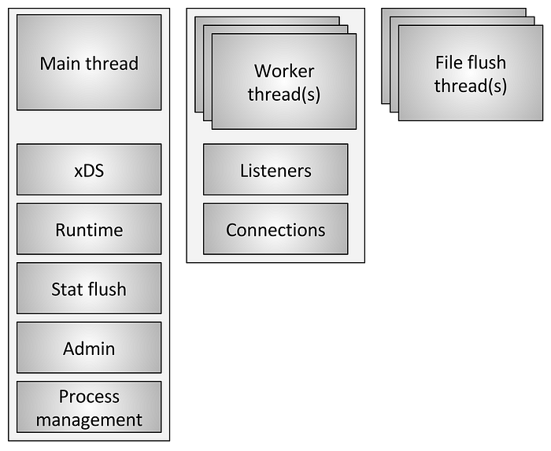
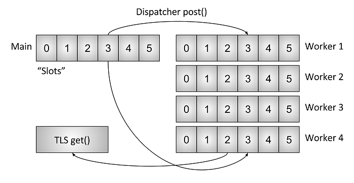
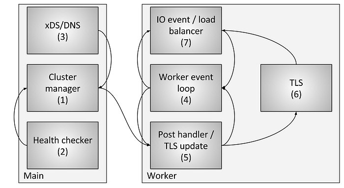

# Envoy threading model

> https://blog.envoyproxy.io/envoy-threading-model-a8d44b922310

Low level technical documentation on the [Envoy](https://github.com/lyft/envoy) codebase is currently fairly sparse. To rectify that I’m planning on doing a series of blog posts about various subsystems. As this is the first post, please [let me know](https://twitter.com/mattklein123) what you think and what other topics you would like to see covered.

One of the most common technical questions I get about Envoy is a request for a low level description of the threading model that it uses. This post will cover how Envoy maps connections to threads, as well as a description of the Thread Local Storage (TLS) system that is used internally to make the code extremely parallel and high performing.

# Threading overview

Figure 1: Threading overview

Envoy uses three different types of threads, as illustrated in figure one.

- **Main**: This thread owns server startup and shutdown, all [xDS API](https://lyft.github.io/envoy/docs/intro/arch_overview/dynamic_configuration.html) handling (including [DNS](https://lyft.github.io/envoy/docs/intro/arch_overview/service_discovery.html), [health checking](https://lyft.github.io/envoy/docs/intro/arch_overview/health_checking.html), and general [cluster management](https://lyft.github.io/envoy/docs/intro/arch_overview/cluster_manager.html)), [runtime](https://lyft.github.io/envoy/docs/intro/arch_overview/runtime.html), stat flushing, admin, and general process management (signals, [hot restart](https://lyft.github.io/envoy/docs/intro/arch_overview/hot_restart.html), etc.). Everything that happens on this thread is asynchronous and “non-blocking.” In general the main thread coordinates all critical process functionality that does not require a large amount of CPU to accomplish. This allows the majority of management code to be written as if it were single threaded.
- **Worker**: By default, Envoy spawns a worker thread for every hardware thread in the system. (This is controllable via the `--concurrency`[ option](https://lyft.github.io/envoy/docs/operations/cli.html)). Each worker thread runs a “non-blocking” event loop that is responsible for listening on every listener (there is currently no listener sharding), accepting new connections, instantiating a filter stack for the connection, and processing all IO for the lifetime of the connection. Again, this allows the majority of connection handling code to be written as if it were single threaded.
- **File flusher**: Every file that Envoy writes (primarily access logs) currently has an independent blocking flush thread. This is because writing to filesystem cached files even when using `O_NONBLOCK` can sometimes block (sigh). When worker threads need to write to a file, the data is actually moved into an in-memory buffer, where it is eventually flushed via the file flush thread. This is one area of the code in which technically all workers can block on the same lock trying to fill the memory buffer. There are a few others which will be discussed further below.

# Connection handling

As discussed briefly above, all worker threads listen on all listeners without any sharding. Thus, the kernel is used to intelligently dispatch accepted sockets to worker threads. Modern kernels in general are very good at this; they employ features such as IO priority boosting to attempt to fill up a thread’s work before starting to employ other threads that are also listening on the same socket, as well as not using a single spin-lock for processing each accept.

Once a connection is accepted on a worker, *it never leaves that worker*. All further handling of the connection is entirely processed within the worker thread, including any forwarding behavior. This has a few important implications:

- All connection pools in Envoy are *per worker thread*. So, though HTTP/2 connection pools only make a single connection to each upstream host at a time, if there are four workers, there will be four HTTP/2 connections per upstream host at steady state.
- The reason Envoy works this way is because by keeping everything within a single worker thread, almost all the code can be written without locks and as if it is single threaded. This design makes most code easier to write and scales incredibly well to an almost unlimited number of workers.
- One major takeaway however is that from a memory and connection pool efficiency standpoint, it is actually quite important to tune the`--concurrency` option. Having more workers than is needed will waste memory, create more idle connections, and lead to a lower connection pool hit rate. At Lyft our sidecar Envoys run with very low concurrency so that the performance roughly matches the services they are sitting next to. We only run our edge Envoys at max concurrency.

# What non-blocking means

The term “non-blocking” has been used several times so far when discussing how the main and worker threads operate. All of the code is written assuming that nothing ever blocks. However, this is not entirely true (is anything ever entirely true?). Envoy does employ a few process wide locks:

- As already discussed, if access logs are being written, all workers acquire the same lock before filling the in-memory access log buffer. Lock hold time should be very low, but it is possible for this lock to become contended at high concurrency and high throughput.
- Envoy employs a very sophisticated system for handling stats that are thread local. That will be the subject of a separate post. However, I will briefly mention that as part of the thread local stat handling, it is sometimes required to acquire a lock to the central “stat store.” This lock should not ever be highly contended.
- The main thread periodically needs to coordinate with all worker threads. This is done by “posting” from the main thread to the worker threads (and sometimes from the worker threads back to the main thread). Posting requires taking a lock so the posted message can be put into a queue for later delivery. These locks should never be highly contended but they can still technically block.
- When Envoy logs itself to standard error, it acquires a process-wide lock. In general, Envoy local logging is assumed to be terrible for performance so not much thought has been given to improving this.
- There a few other random locks, but none of them are in performance critical paths and should never be contended.

# Thread local storage

Because of the way Envoy separates main thread responsibilities from worker thread responsibilities, there is a requirement that complex processing can be done on the main thread and then made available to each worker thread in a highly concurrent way. This section describes Envoy’s Thread Local Storage (TLS) system at a high level. In the next section I will describe how it is used for handling cluster management.

Figure 2: Thread Local Storage (TLS) system

As has already been described, the main thread handles essentially all management/control plane functionality within the Envoy process. (Control plane is a bit overloaded here but when considered within the Envoy process itself and compared to the forwarding that the workers do, it seems appropriate). It is a common pattern that a main thread process does some work, and then needs to update each worker thread with the result of that work, and *without the worker thread needing to acquire a lock on every access*.

Envoy’s TLS system works as follows:

- Code running on the main thread can allocate a process-wide TLS slot. Though abstracted, in practice, this is an index into a vector allowing O(1) access.
- The main thread can set arbitrary data into its slot. When this is done, the data is posted into each worker as a normal event loop event.
- Worker threads can read from their TLS slot and will retrieve whatever thread local data is available there.

Although very simple, this is an incredibly powerful paradigm that is very similar to the [RCU locking concept](https://en.wikipedia.org/wiki/Read-copy-update). (Essentially, worker threads never see any change to the data in the TLS slots while they are doing work. Change only happens during the quiescent period between work events). Envoy uses this in two different ways:

- By storing different data on each worker that is accessed without any lock.
- By storing a shared pointer to read-only global data on each worker. Thus, each worker has a reference count to the data that cannot be decremented while it is doing work. Only when all workers have quiesced and loaded the new shared data will the old data be destroyed. This is identical to RCU.

# Cluster update threading

In this section I will describe how TLS is used for cluster management. Cluster management includes xDS API handling and/or DNS as well as health checking.

Figure 3: Cluster manager threading

Figure three shows the overall flow which involves the following components and steps:

1. The cluster manger is the component inside Envoy that manages all known upstream clusters, the CDS API, the SDS/EDS APIs, DNS, and active (out-of-band) health checking. It is responsible for creating an eventually consistent view of every upstream cluster which includes the discovered hosts as well as health status.
2. The health checker performs active health checking and reports health state changes back to the cluster manager.
3. CDS/SDS/EDS/DNS are performed to determine cluster membership. State changes are reported back to the cluster manager.
4. Every worker thread is continuously running an event loop.
5. When the cluster manager determines that state has changed for a cluster, it creates a new *read-only snapshot* of the cluster state and posts it to every worker thread.
6. During the next quiescent period, the worker thread will update the snapshot in the allocated TLS slot.
7. During an IO event that needs to determine a host to load balance to, the load balancer will query the TLS slot for host information. No locks are acquired to do this. (Note also that TLS can also fire events on update such that load balancers and other components can recompute caches, data structures, etc. This is beyond the scope of this post but is used in various places in the code).

By using the previously described procedure, Envoy is able to process every request without taking any locks (other than those previously described). Beyond the complexity of the TLS code itself, most code does not need to understand how threading works and can be written to be single threaded. This makes most code easier to write in addition to yielding excellent performance.

# Other subsystems that make use of TLS

TLS and RCU are used extensively within Envoy. Some other examples include:

- **Runtime (feature flag) override lookup**: The current feature flag override map is computed on the main thread. A read-only snapshot is then provided to each worker using RCU semantics.
- **Route table swapping**: For route tables provided by RDS, the route tables are instantiated on the main thread. A read-only snapshot is then provided to each worker using RCU semantics. This makes route table swaps effectively atomic.
- **HTTP date header caching**: As it turns out, computing the HTTP date header on every request (when doing ~25K+ RPS per core) is quite expensive. Envoy centrally computes the date header about every half second, and provides it to each worker via TLS and RCU.

There are other cases, but the previous examples should provide a good taste of the kind of things TLS is used for.

# Known performance pitfalls

Although overall Envoy performs quite well, there are a few known areas that will need attention when it is used at very high concurrency and throughput:

- As already described in this post, currently all workers acquire a lock when writing to an access log’s in-memory buffer. At high concurrency and high throughput it will be required to do per-worker batching of access logs at the cost of out of order delivery when written to the final file. Alternatively, access logs can become per worker thread.
- Although stats are very heavily optimized, at very high concurrency and throughput it is likely that there will be atomic contention on individual stats. The solution to this is per-worker counters with periodic flushing to the central counters. This will be discussed in a followup post.
- The existing architecture will not work well if Envoy is deployed in a scenario in which there are very few connections that require substantial resources to handle. This is because there is no guarantee that connections will be evenly spread between workers. This can be solved by implementing worker connection balancing in which a worker is capable of forwarding a connection to another worker for handling.

# Conclusion

Envoy’s threading model is designed to favor simplicity of programming and massive parallelism at the expense of potentially wasteful memory and connection use if not tuned correctly. This model allows it to perform very well at very high worker counts and throughput.

As I briefly [mentioned on Twitter](https://twitter.com/mattklein123/status/872291252695293952), the design is also amenable to running on top of a full user mode networking stack like [DPDK](http://dpdk.org/), which could lead to commodity servers processing millions of requests per second while doing full L7 processing. It will be very interesting to see what gets built over the next few years.

One last quick comment: I’ve been asked many times why we chose C++ for Envoy. The reason remains that it’s still the only widely deployed production grade language in which it is possible to build the architecture described in this post. C++ is certainly not right for all, or even many, projects, but for certain use cases it’s still the only tool to get the job done.

# Links to code

Some links to a few of the interfaces and implementation headers discussed in this post:

- https://github.com/lyft/envoy/blob/master/include/envoy/thread_local/thread_local.h
- https://github.com/lyft/envoy/blob/master/source/common/thread_local/thread_local_impl.h
- https://github.com/lyft/envoy/blob/master/include/envoy/upstream/cluster_manager.h
- https://github.com/lyft/envoy/blob/master/source/common/upstream/cluster_manager_impl.h
